<p align="center">
  
</p>

<p align="center">
  <b>Find tech jobs outside the crowded platforms, see how well each one fits your CV,<br>and build a truthful, ATS-friendly CV for the jobs you choose.</b>
</p>

<p align="center">
  
  
  
  
  
</p>

<p align="center">
  <a href="#how-it-works">How it works</a> ·
  <a href="#quick-start-windows">Quick start</a> ·
  <a href="#daily-use">Daily use</a> ·
  <a href="#job-sources">Job sources</a> ·
  <a href="#privacy-and-security">Privacy</a> ·
  <a href="#faq">FAQ</a>
</p>


## What is Hidden Hire?

Hidden Hire is a personal job search agent for **IT and tech roles** (AI, ML, MLOps, data, software, DevOps). It collects fresh jobs from company career pages, remote boards, country boards, Bangladeshi company sites and Hacker News, then scores every job against your CV on your own computer.

It is built for job seekers in Bangladesh. Every job gets an eligibility label, so you can quickly see if you can apply from Bangladesh.

You stay in control: Hidden Hire finds, scores and prepares. **You always apply yourself.**




## How it works



1. **GitHub Actions** runs the fetcher in the cloud every hour (GitHub often delays or skips scheduled runs, so in practice every few hours), even when your PC is off. It collects jobs, keeps only fresh tech roles at intern to mid level, and removes duplicates.
2. The results go to a **public data repo** ([`estkayon/hidden-hire-data`](https://github.com/estkayon/hidden-hire-data)) as daily JSONL files. It holds public job posts only, no personal data.
3. On **your PC**, `sync` pulls new jobs into a local SQLite database and scores them. The dashboard, your CV, scores and applications all stay on your machine.
4. **Backup:** if the cloud fetch is not running, you can fetch on your own PC with one command.

Jobs older than 10 days are removed automatically. The dashboard shows the last 7 days, and jobs from the last 48 hours get a **New** badge.


## Match score



- **Stage 1** runs on every job, locally and without any AI service. It combines skill overlap, semantic similarity (a small local embedding model), role, seniority and location.
- **Stage 2** runs only when you click **Get recruiter view** on a job. An LLM acts as a technical recruiter and returns a requirement checklist, ATS keyword coverage, blockers and an Apply / Stretch / Skip verdict.
- A blocker (for example "EU work permit required") is only counted when the job post contains a matching quote.
- The score is an explained judgment, not a hiring probability.


## Quick start (Windows)

### 1. What you need

| Tool | Why |
|---|---|
| [Git](https://git-scm.com/downloads) | Clone this repo and pull new jobs |
| Python 3.12 (Anaconda or plain Python) | Backend, sync and scoring |
| [Node.js](https://nodejs.org/) (current LTS) | Dashboard |
| [Tectonic](https://github.com/tectonic-typesetting/tectonic/releases) (optional) | Compiles tailored CVs to PDF |
| A free LLM API key (optional) | Recruiter view and tailored CV |

Without an LLM key, fetching, the dashboard and Stage 1 scoring still work.

### 2. Get the code

```powershell
git clone https://github.com/estkayon/hidden-hire.git
cd hidden-hire
```

### 3. Python environment

With Anaconda:

```powershell
conda create -n hidden-hire python=3.12 -y
conda activate hidden-hire
pip install -r requirements-ml.txt
```

Or with plain Python:

```powershell
py -3.12 -m venv .venv
.venv\Scripts\activate
pip install -r requirements-ml.txt
```

`requirements-ml.txt` includes everything. The first scoring run downloads a small embedding model once.

### 4. Settings

```powershell
copy .env.example .env
copy config\settings.example.yaml config\settings.yaml
```

Open `.env` and set the data repo:

```ini
DATA_REPO_URL=https://github.com/estkayon/hidden-hire-data.git
```

For the recruiter view and tailored CVs, add your own keys to `.env` (see [LLM providers](#llm-providers)).

### 5. Tectonic (for CV PDFs)

Download the Windows build from the [Tectonic releases page](https://github.com/tectonic-typesetting/tectonic/releases), extract it, and put the file at:

```
tools\tectonic.exe
```

The `tools/` folder is git-ignored.

### 6. Build the dashboard (once)

```powershell
cd web
npm install
npm run build
cd ..
```

The backend serves this build, so you do not need a separate dashboard server. Run `npm run build` again after you pull new code.


## Daily use

With your Python environment active, run one command in the project folder:

```powershell
python -m app.main
```

Then open **http://127.0.0.1:8000** in your browser.

- When the app starts, it syncs in the background: it pulls new jobs from the data repo, removes jobs older than 10 days and updates match scores. You can use the dashboard while it runs.
- While the app is open, it syncs again every 3 hours.
- The pill next to **Clear filters** shows when jobs were last fetched. Click **Refresh** to sync right away.
- Press `Ctrl+C` in the terminal to stop the app.

### One-click start (optional, Windows)

If you prefer not to open a terminal, double-click **`start.bat`** in the project folder. It activates the Python environment (a `.venv` folder or the `hidden-hire` conda environment), builds the dashboard if needed, starts the app and opens your browser. If the app is already running, it only opens the browser. Close its window to stop the app.

To get a desktop shortcut with the Hidden Hire icon, run this once:

```powershell
powershell -ExecutionPolicy Bypass -File create-shortcut.ps1
```

The shortcut starts the app with its window minimized. If `assets\hidden-hire.ico` is missing, Windows shows its default icon.

The manual commands above keep working, so use whichever you like.

### First time in the dashboard

1. Open **Profile** and upload your CV as a text PDF (not a scanned image). Check the detected name, links, skills and preferences.
2. Build your **master CV** under **Add to my CV**: import your uploaded CV, or write or load notes (PDF, Word `.docx`, `.txt` or `.md`). Each draft opens as a form you check before it is saved. Tailored CVs use only what is in your master CV. You can edit it any time in the **CV editor**, or remove it with **Delete master CV**.
3. Go back to the job list. Every job now has a match score and an eligibility label.
4. Open a job you like, click **Get recruiter view**, and if it fits, **Generate CV**.
5. Click **Mark as applied** after you apply on the official link.

Found a job on LinkedIn, Facebook or in an email? Use **Paste job** to add it like any other job.

### When the cloud fetch is late

GitHub sometimes delays or skips scheduled runs. If the newest fetch is more than 6 hours old, the app fetches jobs on your own PC before importing (this takes a few minutes). You can also run it by hand:

```powershell
python -m fetcher.run
python -m app.sync
```

Local fetches are written to `data/jobs`. `sync` reads both the data repo and this folder, so nothing is imported twice. If you do not set `DATA_REPO_URL`, the app uses local fetches only.


## Job sources

Every source is its own module. If one fails, the others keep running. Only public pages and public APIs are used.

| Group | Sources |
|---|---|
| Company career pages (ATS) | Greenhouse, Lever, Ashby, Workable, Recruitee, SmartRecruiters, Personio, Teamtailor, Manatal, Recruiterbox, JazzHR |
| Bangladeshi companies | Company boards and WordPress career pages listed in `config/companies.yaml`, plus Bangladeshi tech job boards |
| Remote boards | RemoteOK, Remotive, We Work Remotely, Himalayas, Jobicy, Working Nomads |
| Country boards | Arbeitnow, Bundesagentur für Arbeit, Reed (UK), MyCareersFuture (SG), SEEK / JobStreet, Bulldogjob, Japan Dev |
| Startups | Hacker News "Who is hiring" |

**Not used:** LinkedIn, Indeed, Glassdoor, BDJobs and Facebook groups. They do not allow automated access. Use **Paste job** for posts from those sites.

To add a company, find its careers page, check which ATS it uses, and add one line to `config/companies.yaml`, for example:

```yaml
greenhouse:
  gitlab: GitLab
smartrecruiters:
  DeliveryHero:bd: foodpanda Bangladesh   # ":bd" keeps Bangladesh jobs only
```


## LLM providers

All LLM calls go through one small client built on [LiteLLM](https://github.com/BerriAI/litellm). Each task (scoring, documents) has a fallback chain in `config/settings.yaml`, so if one model hits its limit the next one is tried.

The example settings use providers that do not train on API data:

| Provider | Keys in `.env` |
|---|---|
| [Groq](https://console.groq.com/) | `GROQ_API_KEY` |
| [Cloudflare Workers AI](https://developers.cloudflare.com/workers-ai/) | `CLOUDFLARE_ACCOUNT_ID`, `CLOUDFLARE_API_KEY` |

Free tiers have daily limits. Before you use any other provider, check if it may use your data for training, because your CV is personal.

Your contact details are removed from the CV text before it is sent to an LLM, and job posts are sent as untrusted text that the model must not follow as instructions.


## Privacy and security

- The local server listens on **127.0.0.1 only**. Nothing is open to your network.
- `profile/`, `cv/`, `data/`, `output/`, `tools/`, `*.db`, `.env` and `config/settings.yaml` are git-ignored. They never go to GitHub.
- A [gitleaks](https://github.com/gitleaks/gitleaks) pre-commit hook blocks commits that contain keys.
- API keys live in `.env` locally and in GitHub Secrets in the cloud, and are never written to logs.
- Job posts are treated as untrusted: the dashboard shows them as plain text, and LaTeX output is escaped.
- Tailored CVs are fact-checked against your master CV. If a rewritten line adds a number or skill that is not in your master CV, it is flagged and the original wording from your master CV is used.
- Python and npm dependencies are pinned to exact versions.


## Run your own fetcher (optional)

Most users can use the shared data repo. If you want your own source list and schedule:

1. Fork this repo and create a data repo (public or private).
2. Create a fine-grained token with **Contents: Read and write** on the data repo only, with an expiry date.
3. In your fork, add the GitHub Secrets the workflow uses: `DATA_REPO_TOKEN` (and `REED_API_KEY` if you use Reed).
4. Point `.github/workflows/fetch.yml` at your data repo, enable Actions, and run the workflow once by hand.
5. Set `DATA_REPO_URL` in your `.env` to your data repo.


## Project structure

```
hidden-hire/
├── .github/workflows/fetch.yml   # cloud fetch every 3 hours
├── config/                       # companies, keywords, countries, prompts, settings example
├── fetcher/                      # runs in GitHub Actions, no personal data
│   ├── sources/                  # one module per job source
│   ├── filters.py  normalize.py  dedup.py  store.py  run.py
├── app/                          # local only
│   ├── api/                      # FastAPI routes
│   ├── scoring/                  # Stage 1 rules, embeddings, Stage 2 recruiter view
│   ├── documents/                # master CV, tailored CV, LaTeX template, fact check
│   ├── llm/                      # LiteLLM client with fallback chain
│   ├── sync.py  main.py
├── web/                          # React + Vite dashboard
└── tests/
```

## Development

```powershell
python -m pytest -q
ruff check app fetcher tests
cd web; npm run build
```


## FAQ

<details>
<summary><b>Do I need a GitHub account?</b></summary>

No. The shared data repo is public, so `sync` can pull it without logging in. You only need an account if you run your own fetcher.
</details>

<details>
<summary><b>Does it apply to jobs for me?</b></summary>

No. Hidden Hire never submits applications or sends emails. It gives you the official apply link, and the application email only when the job post states one.
</details>

<details>
<summary><b>The dashboard shows no new jobs.</b></summary>

Click **Refresh** next to **Clear filters**, then check the **Sources** page for the last fetch time and errors per source. If the cloud fetch is more than 6 hours old, the app fetches on your PC automatically.
</details>

<details>
<summary><b>CV upload says "No text found in the PDF".</b></summary>

Your PDF is a scanned image. Export your CV again as a text PDF (from Word, Google Docs or LaTeX) and upload that.
</details>

<details>
<summary><b>Generate CV fails.</b></summary>

Check that `tools\tectonic.exe` exists and that your `.env` has a working LLM key. The first compile can take a minute while Tectonic downloads its packages.
</details>

<p align="center">
  
</p>
